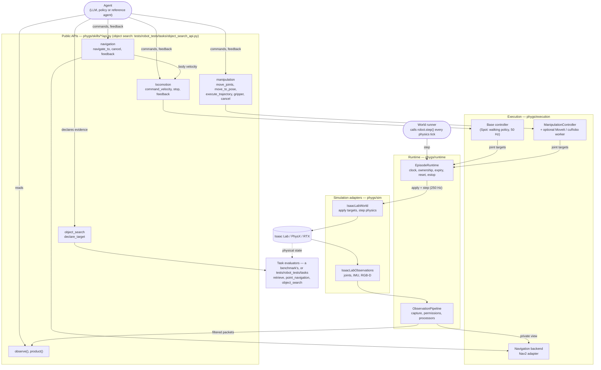
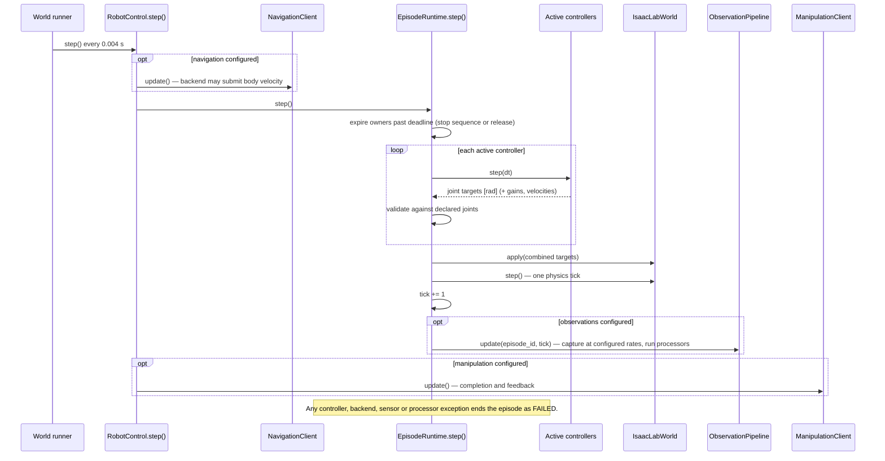
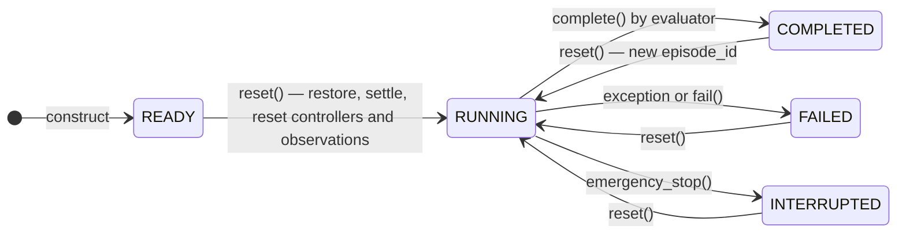
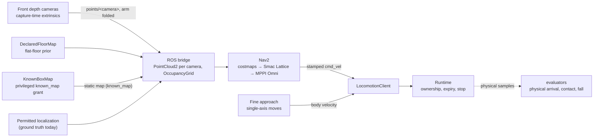

# Architecture

This document describes how Interactive Search is built: the shared runtime, the
public skill APIs agents call, their execution backends, observations, tasks and
tests. The older Spot SDK / AO-Grasp / CuRobo stack was removed on 2026-10-08 (see
[the last section](#removed-spot-sdk-facade-ao-grasp-and-curobo-runner)).

Topic guides with usage and measurements are listed in the [docs index](docs/README.md).

## At a glance

Agents call the public skill APIs on an assembled robot (`RobotControl`, built from the robot's
description: [adding a robot](docs/adding_a_robot.md)). The
World owns stepping. Every joint target passes through one runtime,
which owns the clock, joint ownership, expiry and reset. Task evaluators read
physical state independently of skill feedback.

| Layer | Where |
| --- | --- |
| The world and the agent session | `phygs/world/` (World, spec, task seam, truth, report), `phygs/session/` |
| Public skill APIs | `phygs/skills/{locomotion,navigation,manipulation}/api.py`, `tests/robot_tests/tasks/object_search_api.py` |
| Robot descriptions and assembly | `phygs/robots/` (`RobotDescription`, `RobotControl`; one folder per robot) |
| Execution | `phygs/execution/` |
| Simulation adapters, recording | `phygs/sim/`, `phygs/recording/` |
| Scenes, runtime and observation pipeline | `phygs/scene/`, `phygs/runtime/`, `phygs/observations/` |
| Tasks and evaluators | A benchmark's; the robot tests' own in `tests/robot_tests/tasks/` |

The packages are layers that import downward only; the order, the rule and its test are in
[docs/layout.md](docs/layout.md).

## Code map

Public locomotion/navigation/manipulation APIs live in `phygs/skills/<name>/api.py`.
During assembly, `RobotControl.create()` explicitly binds navigation
through `LocomotionClient.bind_navigation()`. This one-time binding prevents direct
motion while navigation is active or stopping. Agents continue to use the existing
velocity, stop, and `navigate_to` commands. Nav2 terminal feedback preserves the
original completion, cancellation, or failure reason after physical stopping.
Execution lives in `phygs/execution`; robot assembly (`robots/control.py`) binds it to the public
clients, and the World (`world/world.py`) binds those to the scene and the agent.

| Module | Responsibility |
| --- | --- |
| `runtime/episode.py` | Episode identity/status, integer clock, controller declarations, exclusive joints, bounded ownership, human authority, events. |
| `runtime/pipeline.py` | Capture, task-wide permissions, agent and service views, processor reset and updates. |
| `runtime/commands.py`, `runtime/timing.py` | Shared command bookkeeping; command durations to exact clock ticks. |
| `observations/types.py` | Permitted products, capture stamps, calibrated snapshots, and exact-time transform queries. |
| `observations/localization.py` | Localization provider contract and explicitly privileged ground-truth mode. |
| `observations/front_view.py`, `observations/color_detection.py` | The two front cameras joined into one view; reference colour detectors for diagnostic targets. |
| `scene/registry.py` | Scenes by id: `scene_file(id, version)` looks under `$PHYGS_SCENES`, `~/.cache/phygs/scenes` (fetched releases, version checked), then `tests/robot_tests/scenes`; no spec holds a file path. |
| `scene/fetch.py` | Scene releases from the dataset: download, verify, install with a record (`phygs scenes`). |
| `scene/reader.py` | `UsdScene`: loads any scene USD from its config; objects, drawers, colliders and where an object starts are found in the file by name. |
| `scene/parts.py`, `scene/storage_units.py`, `scene/assets.py`, `scene/types.py` | Drawers from prismatic joints; the house's storage units; USD rigid-body registration for reset; `ArticulatedPart`. |
| `sim/state.py` | Single-environment Isaac Lab snapshot restoration and one actuator-write/physics-step boundary (`IsaacLabWorld`). |
| `sim/observations.py`, `sim/cameras.py` | Isaac Lab measurement capture, publication rates, and filtering before delivery to agents. |
| `sim/base.py`, `sim/arm.py`, `sim/footprint.py`, `sim/fabric.py` | `BaseLink` (the base link's world pose and velocity); Isaac Lab differential IK for the wrist link; live collision bounds; Fabric writes for rendering. |
| `recording/` | The run's video, its panels, the command timeline and the skills' narration. |
| `execution/locomotion/` | Runtime-owned leg targets; policy loading, preprocessing and inference; base controllers. |
| `execution/navigation/` | Immutable occupancy maps, the known-box map (`known_map.py`), the Nav2 backend (adapter, ROS transport, servers), fine approach, footprint, metrics. |
| `execution/manipulation/` | Joint/wrist controller, planning contract and worker, the arm planner host (`ArmPlanner`: known boxes and/or the robot's depth), independent path validation, planner adapters, body-frame boxes (`collision_map.py`). |
| `robots/description.py` | `RobotDescription`: every robot fact, loaded and checked from `robots/<name>/robot.yaml` (no Isaac imports); `RobotInfo`, what agents read (`session.robot`). |
| `robots/scene.py` | The robot's articulation, cameras and IMU from its description, the ground and the light; the simulation settings. |
| `robots/control.py` | `RobotControl`: the robot's base controller (`base.kind`), runtime, execution components, pipeline and public clients, assembled once. |
| `robots/spot/`, `robots/ridgeback_franka/` | One folder per robot: `robot.yaml` and the robot's own code (Spot: `SpotLegActuator`, the walking policy wrapper) and data (policy, calibrations, transit footprint). |
| `robots/posture.py` | Diagnostic arm interpolation used by `ArmClient`. |
| `session/session.py`, `session/hints.py` | `AgentSession` (action-filtered clients on the main thread, time requests, audit) and grant-checked privileged hints; `phygs.session` re-exports what agents use. |
| `world/spec.py` | Self-contained episode specs (schema 3: scene by id, robot start, object placements, an opaque task block, actions, observations, grants, budget, seed); agents by name (`load_agent`); no Isaac imports. |
| `world/task.py` | The task seam: the `Task` protocol the World takes (public goal and description, privileged target, `brief()`, `reset()`, `update()`, `result(truth, end)`, `provenance()`), `EpisodeEnd` and `NoTask`. The framework never imports a task. |
| `world/world.py`, `world/build.py` | `World`: builds an episode (the pure steps in `build.py`: settings and overrides, refused combinations, cameras, observation access), owns the main-thread loop, runs an agent, stops, evaluates, writes the report. |
| `world/truth.py` | `Truth`: ground truth for the evaluator and robot tests. |
| `world/navigation.py` | Nav2 for the World: the live footprint check, the map source (known boxes or cameras), the servers. |
| `world/report.py`, `world/recorder.py`, `world/provenance.py` | The report schema and its keys; the episode folder (`report.json`, arm `contacts` apart from the grasp's `grasp_contacts`, the video); robot and scene USD hashes over their layers, policy hashes, git commit. |
| `tests/robot_tests/tasks/` | The robot tests' tasks, outside the framework: `load_task(block)` builds the task object from a spec's task block; `RetrieveTask` (brief and evaluator: held, stowed, upright, in time; conduct: unintended contact, drawers left open; thresholds in `retrieve.yaml`, hashed into provenance), point navigation and object search evaluators. A benchmark brings its own. |
| `examples/agents/` | Example agents (`run(session)`), importing only `phygs.session`: `template`, `depth_example`. |

## Runtime: tick, ownership and reset

One `EpisodeRuntime` runs each episode. The World calls
`RobotControl.step()` once per physics tick (0.004 s). Agents never step physics.

Per controller: `idle` → `active` on `acquire()` (all declared joints at once, or
fail) → `stopping` on `request_stop()` or on expiry when the controller declares
stop ticks → `idle` on release. Release holds measured positions, except setpoints
returned by `HoldingController.hold_targets()` (for example a closed gripper).

Observation capture runs after the runtime physics step; the settled reset captures
tick zero. The world updates finite-difference sensors at every physics step, while
the observation adapter publishes state and camera samples at configured rates.
`RobotControl.observe()` returns detached snapshots without advancing the clock.
Ground-truth localization is opt-in and recorded in episode results; sensor-only
packets contain no world transforms. See [observations](docs/observations.md).

Controllers are registered during trusted setup. Each declares its exact joint
set and human/autonomous origin. Acquiring an overlapping set fails atomically.
Acquisition initializes controller memory from measured joint positions. On each
tick the runtime validates all controller outputs before applying their combined
targets and stepping physics. Expiry/release holds current measured positions.
A whole-body controller uses the same contract with all robot joints declared.

Reset clears ownership, restores the registered scene snapshot and actuator
buffers, performs a fixed settling interval, then initializes controller memory.
Controller reset, execution and backend failures terminate the episode. Estop
permanently interrupts the episode; only reset permits execution again and creates
a new identity. Human controllers cannot acquire joints in autonomous mode.
Lifecycle completion is not itself evidence of task success.

This adapter supports revolute-joint position control and explicit-PD gain changes
for one robot, and hands explicit-actuator joints to PhysX joint drives
(`JointTargets.drive_stiffness` / `drive_damping`; the locomotion stand uses it). Gains are
validated against owned joints and restored on reset. A stoppable controller may set its stop
interval when the stop is requested (`TimedStopController.stop_duration_ticks`). Every dynamic entity must be registered in `InteractiveScene`.
Deformables, object collections and surface grippers are rejected explicitly.
The snapshot uses this checkout's native `xyzw` quaternion ordering; the existing
Spot YAML uses `wxyz`, converted by the scene factory. All positions are in meters,
joint angles in radians and durations in seconds or explicit integer ticks.

## Observations and pipelines

`runtime/pipeline.py` separates task information permissions, captured products,
agent-visible observations and private service views. It owns processor reset and
updates. `observations/types.py` filters packets and reconstructs permitted
transform graphs; hiding localization also removes global transforms.
`observations/localization.py` defines a sensor-only estimator extension
with explicit reference frame and capture-time poses. No estimator is required.

Navigation factories own their dependencies and accept a `NavigationContext` with
no map argument. The Nav2 factory gets its map source (known boxes or the depth cameras) from
`world/navigation.py`; other stacks may consume observations and maintain their own representations.
Framework-derived products are optional and retain their native snapshot types.
The agent-facing skill APIs remain under `phygs/skills/`.

See [configuration, ownership and migration](docs/pipelines.md) and the pipeline contract tests.
Remaining work includes a native Nav2 sensor bridge, a real estimated
localization implementation, rate-limited route-aware replanning, and recorded
observation replay. These are independent extensions, not prerequisites for raw
observation agents.

## Locomotion

| Module (execution paths relative to `phygs`) | Role |
| --- | --- |
| `phygs/skills/locomotion/api.py` | Public velocity, stop, command ID and feedback interface. |
| `execution/locomotion/controller.py` | Runtime-owned leg execution and stop behavior. |
| `execution/locomotion/base.py` | `BaseController`, the base controller contract; the command dead band and deceleration every base shares. |
| `execution/locomotion/planar.py` | `PlanarJointBase`: velocity targets on a base's x, y and yaw joints (Ridgeback-Franka). |
| `robots/spot/policy.py` | Spot's walking policy: loading, preprocessing, inference and target computation. |
| `robots/scene.py` | The robot's articulation and sensor configuration. |
| `robots/control.py` | Bind the robot, runtime, skill clients and observation provider. |
| `robots/posture.py` | Diagnostic arm interpolation for `ArmClient`. |

`robots/control.py` assembles the runtime and skill clients once.
`execution/locomotion/controller.py` preserves policy timing and preprocessing.
Runtime expiry can execute a declared stop sequence while retaining joint ownership.
Renewing a command preserves policy state. Reset restores physical velocities but
sets desired PD velocity/effort targets to zero; physical state is not a command.
The walking wrapper computes leg-only targets without actuator writes; the runtime
controller routes position and gain outputs through the shared world backend.
The keyboard locomotion launcher runs through `RobotControl` in human mode.
Other old launchers remain independent diagnostics until migrated.
Agents do not step controllers or policies. The same
`tests/robot_tests/components/check_locomotion.py` runs automated checks, or keyboard control with `--manual`. See
[the locomotion contract](docs/locomotion.md) for usage and validation.

## Navigation

Navigation runs on Nav2 only; the built-in A* planner and follower were removed on 2026-10-25.
`world/navigation.py` (`nav2_navigation`) builds it for the episode's World and the
robot UI alike: it checks the live collision geometry against the measured footprint profile,
chooses the map source and starts Nav2's servers (`backends/nav2_stack.py`). By default Nav2's
obstacle layer maps the two front depth cameras' point clouds on a flat floor unknown beyond 1 m of
the robot's start (`point_cloud.explored_radius`); the
privileged `known_map` grant gives it the scene's boxes as a static map instead. The
World does not build maps for navigation.

`RobotControl.navigation.navigate_to(x, y, heading)` submits a goal; the runtime step advances
Nav2's control, locomotion and physics. Camera clouds are published between goals only while the
arm is folded. A goal Nav2's costmap reports occupied within `occupied_goal_reach` is finished by
the fine approach; a controller without a valid command (`NO_VALID_CONTROL`) replans. The robot
UI shows Nav2's global costmap. Task action permissions are bound into the public robot clients
at construction.

The evaluators consume physical samples independently of skill feedback. The scope is planar
indoor navigation with the measured folded-arm standing outline, planned by Nav2 as a padded
rectangle; see [navigation](docs/navigation.md).

### Navigation execution

`phygs/skills/navigation/api.py` preserves the agent API and binds a `NavigationBackend`.
`execution/navigation/backends/nav2.py` owns the external action lifecycle;
`execution/navigation/backends/ros2.py` isolates ROS dependencies, map/pose/point-cloud
publication, timestamps and velocity reception. External commands pass through the same
locomotion client, resource ownership, expiry and runtime clock. A goal is finished with
`execution/navigation/fine_approach.py` (single-axis moves from settled poses; internal to
`navigate_to`, not a skill). Reset awaits external cancellation. Transport timeout prevents
connection reuse. The simulator still owns emergency termination and the evaluator judges
physical arrival.

`sim/footprint.py` projects live enabled collision bounds;
`execution/navigation/footprint.py` accumulates and validates the measured envelope.
The robot's measured transit footprint (`navigation.footprint_profile`; Spot's
`robots/spot/navigation/transit.json`) records geometry, policy and asset identities. ROS launch
settings live in `phygs/configs/navigation/nav2.yaml` and `phygs/execution/navigation/launch/nav2.launch.py`.
See [setup, measurements and limitations](docs/nav2.md).

Episodes start Nav2 themselves (`execution/navigation/backends/nav2_stack.py`).
`tests/robot_tests/components/check_nav2_pipeline.py` owns only diagnostic subprocess lifecycle for
the house search: Nav2 launch (`pointcloud`, the configuration episodes and the UI use) plus the
Spot search test (`check_house.py`).

The Nav2 transport also publishes the planner action's returned `nav_msgs/Path`
on a latched diagnostic ROS topic. `phygs/configs/navigation/spot_nav2.rviz` visualizes
that path, Nav2 costmaps, occupancy, point cloud and TF; it is observation only
and does not change command ownership or simulation timing.

## Mapping

Nav2 builds the navigation maps; the framework has no occupancy mapper of its own (the depth
mapper, `ObservedDepthMap` and the frontier selector were retired on 2026-10-26). The bridge
unprojects each sensor camera's permitted depth at its capture time, keeps one point per 5 cm voxel
and publishes it with the capture-time transform; Nav2's `VoxelLayer` marks the points in the height
band and clears along every ray in 3D. See [mapping](docs/mapping.md) and
[nav2](docs/nav2.md#native-pointcloud2-obstacle-input).

### Map providers for the Nav2 backend

`execution/navigation/map.py` defines `MapProvider` and the additive
`RawMapProvider` contract. `snapshot()` supplies a grid inflated for the robot;
`raw_snapshot()` supplies the same obstacle/unknown evidence before robot inflation.
Both grids are immutable. Unknown cells are blocked and also carry a separate mask.
`KnownBoxMap` (privileged known boxes) and `DeclaredFloorMap` (`execution/navigation/floor.py`: the
flat floor, optionally unexplored beyond the spawn disk) are the providers; the bridge publishes the
raw grid as Nav2's static map (-1/0/100 for unknown/free/occupied). Nav2 owns its costmap inflation
from the measured outline and padding. Episode IDs fence observations across resets.

### House scenes and exploration

`scene/assets.py` registers existing USD rigid bodies before Spot is
spawned, so the shared world snapshot restores the house as well as the robot.
Ordinary joint-connected bodies retain their authored physics. Scene articulations
require an explicit configuration and fail early in this registration path.

`navigation.explore()` (`phygs/skills/navigation/api.py`) is one command on the Nav2 backend:
the bridge starts explore_lite on Nav2's global costmap and serves its `NavigateToPose` goals, each a
leg followed like `navigate_to` ([nav2](docs/nav2.md#frontier-exploration)). Agents may instead
choose viewpoints themselves. No estimated-localization provider is required for this milestone.

## Manipulation

### Basic manipulation in the shared runtime

- `phygs/skills/manipulation/api.py`: joint/wrist/gripper submission, command IDs,
  cancellation, and measured feedback. Imports no grasp or collision library.
- `phygs/execution/manipulation/controller.py`: quintic joint
  trajectories, convergence/stop checks, timeout, and arm/gripper ownership.
- `phygs/sim/arm.py`: Isaac Lab differential IK; world-frame
  wrist-link pose and matching world Jacobian, including floating-base DoF indexing.
- `sim/state.py`: gravity feedforward for the configured implicit arm drives,
  refreshed each physics tick; the shared world still owns all physical stepping.
- `robots/control.py`: optional assembly with `manipulation=True` (the arm, gripper and tools of the robot's description). Navigation
  remains subject to its folded-arm envelope; basic manipulation is free-space only.

The controller remembers the last commanded gripper angle and keeps it as the gripper
target in later arm commands, when stopping, and after release, through the runtime's
optional `HoldingController.hold_targets()` hook; other released joints hold measured
positions. A gripper that stops short of its target after the motion time has closed
on an object: `close_gripper` then succeeds with reason "Gripper stopped on an object"
and holds `motion.grip_squeeze` (0.05 rad) past the contact angle. Stillness is judged
from measured position changes, because PhysX reports nonzero joint velocity in
sustained contact. The gripper drive uses the URDF `arm_f1x` limit (15.32 N·m).

Manipulation skills (`stow` and `look_at`) sit on the same client: a skill is a generator in
`execution/manipulation/skills/` that issues one low-level command at a time and turns
failures into `SkillFailure` reasons. Backends `collision_avoidance_planner` and `direct`
differ only in how the arm reaches and whether the approach is checked. Grasped objects
are never attached in physics; a picked object's box joins the planner request, the
trajectory guard and the map's robot voxels while the gripper still holds it. See [manipulation skills](docs/manipulation_skills.md).

Joint trajectories have configured reference velocity/acceleration limits.
Cartesian control is a local servo, not a collision-checked trajectory; excessive
reference velocity fails the command. It provides no acceleration certificate or
singularity-escape planner. Sensor packets continue to use the existing capture-time
transforms and episode identity. No manipulation-specific camera pipeline was added.

### Collision-aware planning experiments

The planning experiments (`check_manipulation_planning.py`, replaced on 2026-10-28 by the
arm-planning and pick-and-place agent tests) generated conservative full-robot collider geometry,
used asynchronous planning, and independently validated timed paths and depth
coverage. See
[qualification behavior and remaining limits](docs/manipulation_planners.md#execution-qualification).
Full-model MoveIt execution has passed; cuRobo needs further qualification with
the larger model. Automatic observation-view selection remains open.

Depth planning uses Spot's onboard `frontleft`, `frontright` and
`hand` depth cameras, declared in YAML. Their range is set on the USD camera prims.

Convex-hull robot colliders use conservative hull-plane cell pruning before sphere
export. Other collider representations retain bounding-box coverage. Geometry
construction remains shared between planner backends and independent validation.

One arm planner host, `execution/manipulation/arm_planner.py` (`ArmPlanner`), serves the
episodes and their robot tests (known boxes or depth, as the spec grants) and the robot UI (depth). In depth
mode each plan carries the cameras' current images; the planner rebuilds its library map in
the body frame (cuRobo `Mapper` ESDF, MoveIt Octomap) and the library removes the robot's and
the held object's pixels itself (cuRobo `RobotSegmenter`, MoveIt's Octomap shape mask on the
link frames). Our depth mapper feeds navigation and the independent trajectory guard.
Observed obstacles block motion and unknown space does not; the evaluator measures contact
in unseen space.

The skills (`stow`, `look_at`) and the low-level commands are described in
[manipulation skills](docs/manipulation_skills.md).
There are no pick, place or drawer skills: an agent composes them from `move_to_pose`,
end-effector trajectories (`execute_trajectory`) and the gripper commands (see the robot tests' routines, `tests/robot_tests/routines/`).

## Scenes and assets

Released scenes live in the scene dataset on Hugging Face as immutable releases (one scene id at
one version: a ZIP, a manifest with its SHA-256 and USD entry point, a catalog listing every
manifest). `phygs.scene.fetch` downloads and verifies a release into the local scene cache and
writes a record the scene registry reads, so a spec pins `scene: {id, version}`; nothing downloads
during a simulation. Scenes are made and published outside PhyGS; [docs/scenes.md](docs/scenes.md) has the
release format PhyGS reads.

Catalog discovery also supports scene-ID subsets and all catalogued releases without
a local YAML. Each command resolves one Hub commit and generates per-scene local
records under `CACHE/records/COMMIT/SCENE-VERSION.json`.

| Source | Usage |
| --- | --- |
| `phygs/robots/spot/assets/` | Spot robot, cameras, URDF/USD, cuRobo config; `spot_description` (submodule) for the meshes. |
| `tests/robot_tests/scenes/` | The robot tests' fixture scenes (grid storage, navigation course, dynamic course), as files. |
| `~/.cache/phygs/scenes` (`$PHYGS_SCENES`) | Fetched scene releases (`phygs.scene.fetch`) and any local scene folder; specs name scenes by id. |

Benchmark launchers should reference assets explicitly through YAML config when possible.

## Episodes

One entry point, `examples/run_world.py`, runs an episode spec (e.g. `tests/robot_tests/configs/episodes/*.yaml`) with
an agent. The entry point builds the task object from the spec's task block (`phygs_robot_tests.tasks.load_task`) and
passes it in; the `World` loads the spec's robot (`robot.model`, or `--robot`), finds the scene by id, builds it, creates `RobotControl` with the
spec's actions (`allowed_actions`) and grants (pipeline access, known-box navigation, object
access for the skills, scene hints), and owns the simulation loop on the main thread. The agent runs
`run(session)` in its own thread; every session call runs on the main thread between ticks, and
simulated time passes only while the agent waits (`charged` clock) or always (`realtime`).
Privileged information reaches agents only through granted `session.hints` calls and granted
skill targets; `audit.jsonl` logs every call. The evaluator is separate and never given to the agent: the World resets it on the settled world before the agent starts, has it sample ground truth while the agent runs, and at the end stops the robot (every command cancelled, the grip kept), settles, and asks it for the result.
Robot tests hold the World and may read ground truth (`World.truth()`). A benchmark author's view
of the same: [docs/world.md](docs/world.md).

## Tests

| Test type | Location | Runtime |
| --- | --- | --- |
| Pure Python unit tests | `tests/test_*.py` | Standard Python environment with local dependencies. |
| IsaacLab robot checks | `tests/robot_tests/{episodes,components}/check_*.py` | Require Isaac Sim, Isaac Lab, GPU, assets, and camera support. |

Robot tests form a ladder in the order the framework is built ([tests/robot_tests/README.md](tests/robot_tests/README.md);
`run_suite.py ladder --upto N`). Each spawns a scene, has the robot do one thing, and shows (`--record`),
checks (`DIR/check.json`) and serves as the reference for using that part. A test takes the shape its
subject's real user would write: what an agent asks for (navigation, arm planning, pick and place,
drawers, retrieve, the entry point) is an agent test, `episodes/check_*.py`: an episode spec, a plan
through the agent session only, and checks on the test side from ground truth after the run
(`World.truth()`) and during it (`World.run(during=...)`, called every tick). The
machinery carrying out an agent's requests (stage and reset, sensors, gait, footprint, the arm's joint
controller) has component tests, `components/check_*.py`, which drive the modules directly and build
the robot from the files episodes use. All are automatic and headless by default and take
`--output DIR`; settings are in `tests/robot_tests/configs/`, the robot is `--robot` (default the spec's, or `spot`).
Smoke checks are intentionally stricter than demos:

- They validate config paths.
- They verify planner workers and sensors before execution.
- They verify cameras before planning.
- They verify target AABB resolution.
- They exit with a non-zero error on missing prerequisites or failed planning.

Pure tests should be kept narrow and deterministic. IsaacLab checks should validate
integration and runtime assumptions. Exact commands are in [tests/README.md](tests/README.md).

## Failure model

The benchmark should fail clearly for:

- Missing robot, scene, policy, or planner config files.
- Missing camera sources or missing depth frames.
- Missing target AABB.
- Missing arm, gripper, or end-effector joints/bodies.
- Missing CUDA or planner runtime dependencies.
- Forbidden observation inputs or privileged sources (checked before simulation).
- Planner failure, manipulation timeout or terminal failure feedback.

The benchmark should not silently patch over these failures.

## Extension points

To add a robot: one folder with a `robot.yaml`, plugins only for its base controller and actuators,
then the robot-test ladder with `--robot` ([adding a robot](docs/adding_a_robot.md)).

To add a new skill:

1. Add the public method to `phygs/skills/<name>/api.py`; keep request/result types small.
2. Put execution under `phygs/execution/<name>/`; it submits joint
   targets only through runtime-owned controllers.
3. Bind it once in `robots/control.py` and gate it with an `allowed_actions` entry.
4. Add pure unit tests for API behavior.
5. Add a rung to the robot-test ladder if the skill touches simulation: an agent test
   (`tests/robot_tests/episodes/`, a spec and a plan through the session) when agents call it, a
   component test (`components/`) for machinery under the session.

To add a new benchmark task:

1. Add a task YAML with robot, scene, target, and timeout sections.
2. Reference concrete USD assets and target prim paths.
3. Add a task evaluator under `tests/robot_tests/tasks/` (or a benchmark) that reads physical state.
4. Save result artifacts.
5. Add documentation and a check command.

## Removed: Spot SDK facade, AO-Grasp and CuRobo runner

The stack that predated the shared runtime was removed on 2026-10-08: the Spot-SDK-shaped
facade (`phygs/skills/spot`, `core.py`, `base.py`), the AO-Grasp client, sidecar
services and viewers, the CuRobo runner (`manipulation_skill.py`, `curobo_interfaces.py`),
the camera/point-cloud helpers, `scripts/phygs.py`, their configs and tests,
and the fixed-base drawer smoke tests. The last version is in git history before that
date. Grasping, placing and drawers now run through `robot.manipulation` skills with
MoveIt or cuRobo V2 planning (see [manipulation skills](docs/manipulation_skills.md));
drawers are checked by `tests/robot_tests/episodes/check_drawer_stroke.py` and the other episode tests.
