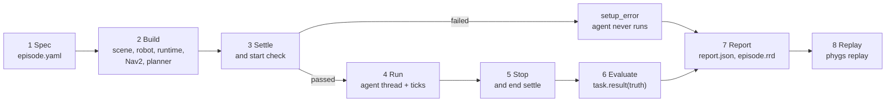
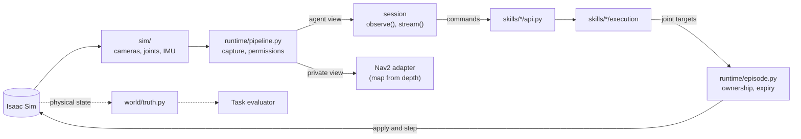

# Pipeline: one episode, step by step

What happens, in order, when `phygs run` (or any benchmark) runs one episode, and what data each step
reads and writes. The parts and their boundaries are in [ARCHITECTURE.md](ARCHITECTURE.md); the
benchmark author's view of the same run is [docs/world.md](docs/world.md). The *observation*
pipeline (which views of the sensors an agent or a service may read) is a different, smaller thing:
[docs/pipelines.md](docs/pipelines.md).

## The steps

| # | Step | Reads | Writes | Where |
| --- | --- | --- | --- | --- |
| 1 | **Spec and task.** The spec is loaded and validated without Isaac Sim. The caller builds the task object from the spec's task block (`--task_loader`) and picks the target. | `episode.yaml` (schema `SCHEMA`: scene by id and version, robot and start, objects, an opaque task block, `actions`, `observations`, `grants`, budget, seed) | An `EpisodeSpec`; a `Task` | `world/spec.py`, `world/task.py` |
| 2 | **Build.** The World finds the scene by id, loads the robot's `robot.yaml`, spawns both, assembles the robot's controllers, runtime, observation pipeline and skill clients, starts Nav2 and creates the arm planner if the spec uses them, and opens the output folder and the recording. | The scene's USD file; `robots/<name>/robot.yaml`; `world/environment.yaml` with the caller's `overrides` | The output folder; `episode.rrd` opened | `world/world.py`, `world/build.py`, `world/robot.py`, `scene/registry.py` |
| 3 | **Settle and start check.** The robot stands still for `settling_seconds`; the arm planner starts and warms up with the settled legs; the check compares the settled world with the spec (bodies at rest and in place, robot upright, drawers within the spec's opening). | The settled simulation state | The start check's result: `passed`, `problems`, `measured`, `limits`. If it fails, the episode ends as `setup_error` and the agent never runs. | `world/world.py` (`reset`), `world/start.py` |
| 4 | **Run.** The World first writes a `report.json` with `status: running` (run id, spec, provenance hashes, where the recording is), so a run that dies still says what ran. The task is reset on the settled world. The agent's `run(session)` starts in its own thread. Every physics tick, the World steps the robot ([the tick](ARCHITECTURE.md#runtime-tick-ownership-and-reset)); every session call is carried out on the main thread between ticks. Simulated time passes only while the agent waits (`charged` clock) or always (`realtime`). The task samples ground truth every `evaluation_period_seconds`, and its optional `trace()` state goes to the recording under `/eval` after the reset and after each sample; the World reads contacts, watches for a fall and publishes to a viewer if there is one. The run ends when the agent finishes or returns, when the budget of simulated seconds runs out, on an emergency stop or when something breaks. | The agent's calls (commands, `observe()`, hints it is granted); the observation pipeline's filtered packets; ground truth (for the task, never the agent) | The audit of every call; commands with their feedback; the recording's time series (joints, targets, poses, contacts, observations, plans, phases) | `world/world.py` (`run`, `_tick`), `session/session.py`, `runtime/episode.py` |
| 5 | **Stop and end settle.** Every command is cancelled (the grip is kept) within `stop_all_timeout_seconds`, then the robot stands still for `end_settle_seconds`. | Command state | What the stop cancelled and how long it took | `world/world.py` (`_stop_all`) |
| 6 | **Evaluate.** The task's evaluator reads ground truth once and returns its result. It also receives how the episode ended, every recorded contact (the unintended ones and the grasp's squeeze, labelled). The framework never reads the task's answer. | `Truth`; `EpisodeEnd` | The task's result (`evaluation`); in the recording, `/eval/result` (the evaluation, how the episode ended, the first time each flag of the task's `trace()` was true) | `world/task.py`, `world/truth.py` |
| 7 | **Report.** The World composes `report.json` from the keys in `world/report.py` and replaces the stub. `status` says whether the episode can be scored: `completed`, `setup_error` or `error` (only `completed` counts in a rate). The recording is closed. | Everything above | `report.json` (keys: [`KEYS`](phygs/world/report.py)); `episode.rrd`; the Nav2 and planner logs | `world/report.py`, `world/recorder.py`, `world/provenance.py`, `recording/log.py` |
| 8 | **Replay (afterwards).** `phygs replay <run>` renders the run again from `report.json` and `episode.rrd`, with the run's own camera code and settings, without control, Nav2 or the planner. | `report.json`, `episode.rrd` | `<run>/replay/replay.mp4`, `trace.json`, optional per-view clips | `world/replay.py`, `recording/` |

A World can run the same spec again without building again (`World.next_episode`): steps 3 to 7
repeat in a fresh output folder and recording, with the robot and every scene body restored to the settled start.

## Data inside the run (step 4)

- **Observations** leave the simulator as plain measurements (`observations/types.py`), stamped at
  capture time, and reach an agent only through its permitted view.
- **Commands** go from a client to its execution code, which submits joint targets only through the
  runtime; the runtime applies them, once per tick, to the simulator.
- **Ground truth** reaches only the task's evaluator and the robot tests, never an agent. An agent
  learns privileged facts only through grants the spec names (`gt_localization`, `known_map`,
  `object_targets`, `scene_hints`); each use is audited and listed in the report.

Navigation's own data flow (Nav2's costmap, the route, the footprint check):
[ARCHITECTURE.md](ARCHITECTURE.md#navigation).
