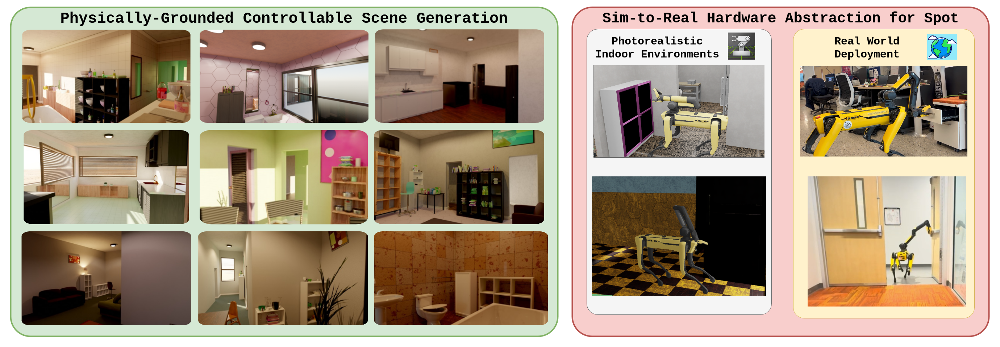

# PhyGS: Physically-Grounded Controllable Scene Generation and Simulation

[](https://m-and-m-lab.github.io/PhyGS/assets/papers/phygs.pdf)
[](https://m-and-m-lab.github.io/PhyGS/)
[](https://developer.nvidia.com/isaac/sim)
[](LICENSE)

[Aparajito Saha](https://aparajitosaha.github.io)<sup>1</sup>, [Zhen Hao Gan](https://ganzh6880.github.io)<sup>1</sup>, Jinjia Guo<sup>1</sup>, Jacob Skwirsk<sup>1</sup>, Jeremy Acheampong<sup>1</sup>, [Anton Arapin](https://anton-arapin.github.io)<sup>1</sup>, [Chahyon Ku](https://chahyon-ku.github.io)<sup>1</sup>, [Yue Hu](https://phyllish.github.io)<sup>1</sup>, [Nima Fazeli](https://www.mmintlab.com/people/nima-fazeli/)<sup>1</sup>, [Bernadette Bucher](https://bucherb.github.io)<sup>1</sup>

<sup>1</sup>University of Michigan, Ann Arbor

**[Project page](https://m-and-m-lab.github.io/PhyGS)** &nbsp;·&nbsp; **[Paper (CVPR 2026 MEIS Workshop)](https://m-and-m-lab.github.io/PhyGS/assets/papers/phygs.pdf)**

PhyGS is a simulation framework for mobile manipulation in Isaac Lab: photorealistic, building-scale indoor scenes generated with physics (articulated drawers, rigid bodies, ray-traced light), a robot with an arm walking in them under a learned policy, a shared runtime with one clock and exclusive ownership of every joint, public skill clients an agent calls the way it would call a robot SDK, and measurement that reads the physics, never the skills' own feedback. It is built to run and score mobile manipulation tasks that are intractable to run at scale in the real world. PhyGS names no task: a benchmark such as [ForageBench](https://github.com/m-and-m-lab/ForageBench) brings its tasks, episodes and scoring and runs them on this framework.

<p align="center">
  
</p>

## 📄 Abstract

The pursuit of generalist robot policies requires evaluation spanning variations of visual environments and physical interactions intractable for a robot to execute in the real world. We introduce PhyGS, a simulation framework designed for the controllable generation of photorealistic, building-scale indoor environments with high-fidelity low-level physics that bridges the gap between procedural scene synthesis and robotic control. By extending Infinigen-Indoors within the IsaacSim ecosystem, PhyGS transforms static visual backdrops into fully interactable environments through automated object articulation, the assignment of rigid-body physical properties, and the integration of ray-traced lighting. Unlike recent agent-based generative tools that rely on stochastic language models, PhyGS employs a rule-based approach to ensure the controllability required for rigorous benchmarking. Finally, we provide a hardware abstraction layer via a unified API and USD model for the Boston Dynamics Spot robot, demonstrating a seamless transition between simulated evaluation and physical deployment to help identify critical performance gaps in state-of-the-art generalist robotic agents.

## ⚠️ Note on usage

PhyGS is under active development at the [Mapping and Motion Lab](https://sites.google.com/umich.edu/mandmlab/), and this version of the repository is a beta release intended for early community testing and usage. Please file a GitHub issue detailing any bugs faced or major feature requests, and the team will respond to and resolve these issues as soon as possible.

The `main` branch is the May 2026 beta (`phygs_simulation/`). The `develop` branch is the framework described below; it becomes the next release.

## 📦 What PhyGS is

Four parts, in one Python package (`phygs`) plus a scene generator in its own environment:

1. **Scene generation** (`scene_generation/`): a fork of Infinigen-Indoors that adds object articulation and semantic population and keeps physics (joints, collision meshes, rigid-body properties, lighting) through export from Blender to USD; the builders of the authored test scenes; the scene packager and publisher. It runs in a separate Python environment (Blender, `bpy`); scenes cross into the simulator as USD files only.
2. **Robot and runtime** (`phygs/robots`, `phygs/runtime`, `phygs/simulation`): a robot is one folder with a `robot.yaml` (joints, gripper tool frames, cameras by role, limits) and code only for its base controller and actuators. Spot with arm is the reference robot, walking under a learned policy at 250 Hz physics; Ridgeback-Franka is the second robot. One runtime owns the clock, every joint, command expiry, reset and the emergency stop.
3. **Skills and backends** (`phygs/skills`, `phygs/execution`): three public clients, `locomotion` (velocity), `navigation` (`navigate_to`, `explore`, on Nav2 with a measured transit footprint, mapping the cameras' point clouds or a known map) and `manipulation` (joint and wrist moves, end-effector lines, gripper, `stow`, `look_at`, with cuRobo or MoveIt planning on known boxes or on depth). Every command has an id, feedback and cancel.
4. **Measurement** (`phygs/episodes`): an episode is a spec (scene by id, robot start, objects, actions, observations, grants, budget, seed); the `Environment` builds it, runs an agent's `run(session)` in its own thread, audits every call, records contacts and a third-person video, and hands ground truth to the task's evaluator once, after the robot has stopped. Provenance in every report: the USD, policy and threshold hashes and the code version.

## 🧲 Honest physics, stated first

- **No attached grasps.** A grasped object is held by friction between the jaws; it can slip and drop. "Held" is measured as the object off its support and inside the hand.
- **Physical drawer strokes.** Drawers are prismatic joints with authored limits; opening one is a planned end-effector line on its handle, and it can jam or bounce.
- **A legged base.** Spot walks under a learned policy; it can stumble, fall (the run ends) and push furniture.
- **Contacts are measured, not prevented.** Every arm-link contact above a threshold is recorded with its peak force and the running command; nothing stops the robot from touching things, and the record goes beside the outcome.
- **Evaluators read physics.** Success is read from object poses, joint states and the base pose, never from a skill's "succeeded". Skill feedback is for the agent.

## 🗂️ Repository structure

```
PhyGS/
├── README.md  AGENTS.md  ARCHITECTURE.md  CHANGELOG.md  PLANS.md  pyproject.toml
├── phygs/                       # The framework (package `phygs`); layout in phygs/README.md
│   ├── robots/                  # spot/ (robot.yaml, policy, assets/, spot_description submodule), ridgeback_franka/, _template/
│   ├── runtime/  simulation/    # Clock and ownership; Isaac Lab state, sensors, USD scenes, maps
│   ├── execution/               # locomotion/, navigation/ (Nav2, launch file), manipulation/ (arm, skills, planners)
│   ├── skills/                  # Public clients: locomotion, navigation, manipulation
│   ├── observations/  tools/    # Observation packets and localization; video, panels, narration
│   ├── episodes/                # Spec, scene registry, Environment, AgentSession, hints, the Task seam, recorder
│   ├── scenes/                  # fetch.py: scene releases from the dataset into the local cache
│   ├── configs/                 # environment.yaml (physics, cameras, Nav2, planner, timing), navigation/, ui/
│   ├── agents/                  # Example agents (template, depth example)
│   └── ui/                      # The robot UI: a person as the agent, in a browser (cli.py, replay_cli.py)
├── tests/robot_tests/           # The robot tests (importable): 15 rungs, routines, test tasks, fixture scenes, run_suite.py
├── tests/                       # Unit tests (no simulator) and the import guards
├── examples/run_world.py        # Run one episode spec with an agent
├── scene_generation/            # infinigen/ (fork, own environment), usd_tools/ (builders, packager, publisher), docs/
├── docker/                      # Isaac Lab container patch (cuRobo)
└── docs/                        # Topic guides, design/ pages, docs/README.md index
```

## 🛠️ Installation

PhyGS runs inside the [Isaac Lab](https://github.com/isaac-sim/IsaacLab) Docker container; scene generation runs in its own environment. Validated against Isaac Sim 5.1.0 and Isaac Lab 2.3.0 on Linux x86_64 with an NVIDIA GPU.

| Step | Command or guide | When |
| --- | --- | --- |
| Clone with submodules | `cd IsaacLab/scripts && git clone --recursive -b develop https://github.com/m-and-m-lab/PhyGS.git` | Always. `scene_generation/infinigen` is only needed to generate scenes. |
| Build and enter the container | From `IsaacLab/docker`: `./container.py start base --files ../scripts/PhyGS/docker/docker-compose.curobofix.patch.yaml`, then `./container.py enter base`; inside: `cd /workspace/isaaclab && ./isaaclab.sh -i` | Always. The patch adds cuRobo and its dependencies ([docker/README.md](docker/README.md)). |
| Install the package | `./isaaclab.sh -p -m pip install -e scripts/PhyGS --no-deps` | Always, from `/workspace/isaaclab`. |
| ROS 2 Jazzy, Nav2, explore_lite | [docs/nav2.md](docs/nav2.md#ros-2-jazzy-setup) | Navigation (every episode, the UI, rungs 6 and up). |
| MoveIt (optional) | [docs/manipulation_planners.md](docs/manipulation_planners.md#dependencies) | Only for `--planner moveit`; cuRobo is in the container. |
| CPU governor | `sudo cpupower frequency-set -g performance` on the host | Recommended; `powersave` costs about 20% real-time factor. |
| Scene generation environment | [scene_generation/docs](scene_generation/docs/) and `scene_generation/infinigen/README.md` | Only to generate scenes. Never mix it with the simulator's Python. |

In every shell that runs an episode or a navigation test:

```bash
source /opt/explore_ws/install/setup.bash   # ROS 2 Jazzy plus explore_lite.
export ROS_DOMAIN_ID=48                     # One per person or simulator on this machine.
export PHYGS=scripts/PhyGS                  # The checkout, relative to the Isaac Lab root.
```

## 🚀 Quick start

All commands run from the Isaac Lab root (`/workspace/isaaclab` in the container). The first three need no download: the grid storage scene is a fixture in the repository. With the package installed, `phygs <command>` (or `./isaaclab.sh -p -m phygs <command>`) runs the same scripts: `phygs run`, `phygs ui`, `phygs scenes`, `phygs tests`, `phygs version`.

```bash
# 1. Run a world with the template agent (it looks around and finishes). The report lands in --output.
./isaaclab.sh -p $PHYGS/examples/run_world.py \
  --spec $PHYGS/tests/robot_tests/configs/episodes/dev_grid_table.yaml \
  --agent template --task_loader phygs_robot_tests.tasks:load_task \
  --output $PHYGS/output_check/$(date +%Y%m%d-%H%M)_grid_table

# 2. Drive the robot yourself: the robot UI in a browser (headless simulator; open the printed URL).
./isaaclab.sh -p $PHYGS/phygs/ui/cli.py --task_loader phygs_robot_tests.tasks:load_task \
  --output $PHYGS/output_check/$(date +%Y%m%d-%H%M)_ui_grid

# 3. The first five robot tests (no ROS needed): spawn and reset, sensors, walking, footprint, arm.
./isaaclab.sh -p $PHYGS/tests/robot_tests/run_suite.py ladder --upto 5

# 4. Fetch a released scene (the dataset is private for now; authenticate once with `hf auth login`).
./isaaclab.sh -p -m phygs.scenes.fetch list
./isaaclab.sh -p -m phygs.scenes.fetch fetch --scene_id bear_loop_house --scene_version 1.0.0
```

`--task_loader` names the function that turns a spec's task block into a task object (its brief, its privileged target, its evaluation). PhyGS knows no task; the robot tests ship a retrieve task for their own use, and a benchmark ships its own. A spec with `task: {goal: none}` needs no loader.

## 🤝 The agent contract

An agent is a function `run(session)`. The session is the only object it needs ([template](phygs/agents/template.py)):

```python
def run(session):
    print(session.task.goal, session.task.description)      # The public brief; nothing about where the target is.
    packet = session.observe()                              # Cameras (RGB-D, calibrated), joints, IMU, localization.
    goal = session.navigation.navigate_to(x=1.0, y=0.0, heading=0.0)
    session.wait(goal)                                      # Simulated time passes only while the agent waits.
    move = session.manipulation.move_to_pose(pose)          # Planned by cuRobo or MoveIt; feedback has the reason.
    session.wait(move)
    session.manipulation.close_gripper()                    # Holding is measured from contact, not assumed.
    session.finish("done")
```

| Part of the session | What it gives |
| --- | --- |
| `observe()`, `time()`, `wait(command)`, `sleep(seconds)`, `stream(camera)` | Observations and time. The clock is `charged` (time advances only while the agent waits) or `realtime`. |
| `navigation`, `manipulation`, `locomotion`, `arm` | The clients the spec's `actions` allow (`skills`, `motion`, `joints` or a list). Each command: an id, `feedback(id)` with status and reason, `cancel(id)`. |
| `grants` and `hints` | Privileged channels the spec grants (`gt_localization`, `known_map`, `object_targets`, `scene_hints`); every use is audited and listed in the report. |
| `finish(reason)` | Ends the episode. The Environment then cancels everything, keeps the grip, settles and evaluates. |

Everything the agent does goes into `audit.jsonl`; the report (`report.json`) has the outcome, the conduct (contacts, drawers left open), the usage of time and grants, the commands and the provenance. Design pages: [the session](docs/design/episode_harness/session.html), [the manipulation contract](docs/design/manipulation_contract/index.html).

## 🤖 Robots

| Robot | Base | Status |
| --- | --- | --- |
| [Spot with arm](phygs/robots/spot/README.md) | Legs, learned walking policy (deployed 2026-10-22) | Reference robot: every robot test |
| [Ridgeback-Franka](phygs/robots/ridgeback_franka/README.md) | Planar joints (omnidirectional) | Bring-up, footprint and navigation pass; arm tests next |

Adding a robot is one folder with a `robot.yaml` ([docs/adding_a_robot.md](docs/adding_a_robot.md)): copy `phygs/robots/_template/`, fill it, run the description test, then bring it up with `components/check_bring_up.py --robot <name>`. Framework code never names a robot's parts; a test enforces it.

## 🏠 Scenes

- **Fixtures** in `tests/robot_tests/scenes/`: grid storage (a drawer unit and a table), the navigation course, the dynamic course. Built by `scene_generation/usd_tools/build_*_scene.py`.
- **Released scenes** (the scene dataset on Hugging Face, `mandmlabresearch/ForageBench`): a catalog of immutable releases, one scene id at one version each. `phygs.scenes.fetch` downloads, verifies (SHA-256, every dependency inside the archive) and installs a release under `$PHYGS_SCENES` (default `~/.cache/phygs/scenes`) with a record the scene registry reads; a spec pins it with `scene: {id: bear_loop_house, version: 1.1.0}`. Publishing a new version: `scene_generation/usd_tools/package_scene.py` then `publish_scene.py` ([docs/scenes.md](docs/scenes.md)).
- **Your own**: any folder `<id>/scene.usd[a|c]` under `$PHYGS_SCENES`. A spec says `scene: {id: <folder>, ground: true|false}`; no spec holds a file path. Generation: [scene_generation/](scene_generation/) (Infinigen fork, own environment) and the builders.
- **The scene contract** the framework reads from a USD: rigid bodies by name, prismatic joints as drawers, colliders for the known map, the robot's start on the floor. The reader is `phygs/simulation/scene.py`.

## 🧪 Robot tests

Every robot test spawns a scene and has the robot do one thing, measures it against thresholds and writes `check.json` and, with `--record`, a video. They form a ladder in the order the framework is built; after a change, run it up to the rung you touched. Full table and commands: [tests/robot_tests/README.md](tests/robot_tests/README.md).

| Rung | What the robot does | Needs |
| --- | --- | --- |
| 1–5 | Spawns and resets; sees (RGB-D alignment, rate, permissions); walks, strafes, turns, stops; its footprint is measured; raises the arm and works the gripper | nothing beyond the container |
| 6–7 | Walks to goals around a wall and in the house; refuses goals in walls and furniture; avoids a box moved into its route | ROS 2, Nav2 |
| 8–10 | Plans arm moves on known boxes and on depth; picks the target next to clutter and places it | cuRobo or MoveIt |
| 11–12 | Opens a drawer by its handle and closes it; carries the target into a drawer | ROS 2, cuRobo |
| 13 | Explores the house kitchen until a colour detector sees the cube | explore_lite |
| 14 | Finds the target in a closed drawer, opens it, picks the target, stows (grid and house) | ROS 2, cuRobo |
| 15 | The template agent through `examples/run_world.py` | ROS 2, cuRobo |

```bash
./isaaclab.sh -p $PHYGS/tests/robot_tests/run_suite.py ladder --upto 10 --record
PYTEST_DISABLE_PLUGIN_AUTOLOAD=1 ./isaaclab.sh -p -m pytest $PHYGS/tests -q -p no:cacheprovider   # Unit tests, no simulator.
```

Rungs that use the house need its release fetched once: `./isaaclab.sh -p -m phygs.scenes.fetch fetch --scene_id bear_loop_house --scene_version 1.1.0`.

## 📚 Documentation

Start at the [docs index](docs/README.md): one guide per topic (observations, pipelines, locomotion, navigation, Nav2, mapping, manipulation skills and planners, adding a robot), the design pages under `docs/design/` (episode harness, manipulation contract, robot portability, the robot UI, the evaluator and the framework/benchmark split) and the scene generation notes. [ARCHITECTURE.md](ARCHITECTURE.md) is the code map and the runtime tick; [CHANGELOG.md](CHANGELOG.md) records every change, including the renames of the repository split.

## 📈 Status and plans

[PLANS.md](PLANS.md) lists milestones, known gaps and the decision log; the [status board](docs/design/visual/status.html) shows each capability and its last physical check. After the move into this repository (2026-10-28) the retrieve, entry-point and navigation rungs were rerun here and pass with Spot; the other rungs last passed in the lab's development tree the same week. Ridgeback-Franka passes bring-up, footprint and navigation.

## 🧭 Coding philosophy

| Rule | Meaning |
| --- | --- |
| Fail fast | Missing cameras, services, target geometry, CUDA backends, invalid joints and bad configs raise clear errors before a long run starts. |
| No silent fallbacks | No switched targets, fake cameras, fake grasps, relaxed planning modes. If a dependency is required, it is required. |
| SDK-shaped API | Spot SDK vocabulary where it fits; the runtime exposes `robot.<skill>` clients with ids, feedback and cancel. |
| Robot-neutral framework | Every robot fact is in its `robot.yaml`; framework code asks the description and never names a part. |
| Measurement over self-report | Evaluators and robot tests read ground truth; the report keeps outcome and conduct apart. |

Rules for contributors and coding agents: [AGENTS.md](AGENTS.md).

## 📝 Citation

If you use PhyGS in your research, please cite:

```bibtex
@misc{2026phygs,
  title     = {PhyGS: Physically-Grounded Controllable Scene Generation},
  author    = {Saha, Aparajito and Gan, Zhen Hao and Guo, Jinjia and
               Skwirsk, Jacob and Acheampong, Jeremy and Arapin, Anton and
               Ku, Chahyon and Hu, Yue and Fazeli, Nima and Bucher, Bernadette},
  note      = {CVPR Workshop on Multi-Agent Embodied Intelligent Systems},
  year      = {2026}
}
```

## 🙏 Acknowledgments

PhyGS builds on a number of open-source projects, including:
[Infinigen / Infinigen-Indoors](https://github.com/princeton-vl/infinigen),
[NVIDIA IsaacSim](https://developer.nvidia.com/isaac/sim),
[IsaacLab](https://github.com/isaac-sim/IsaacLab),
[Objaverse-XL](https://objaverse.allenai.org/),
[cuRobo](https://curobo.org/),
[Nav2](https://nav2.org/),
[explore_lite (m-explore-ros2)](https://github.com/robo-friends/m-explore-ros2),
[MoveIt 2](https://moveit.picknik.ai/),
[spot_description](https://github.com/bdaiinstitute/spot_description).

We thank the authors and maintainers of these tools. Please refer to each project's license and cite them as appropriate.
