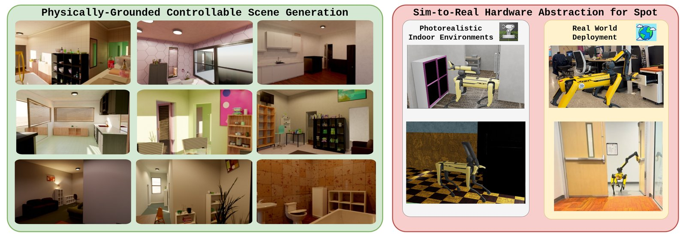
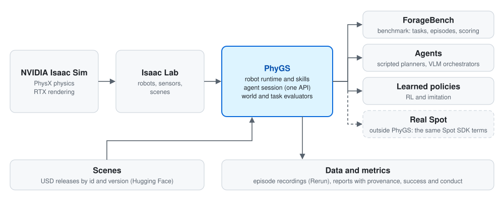

# PhyGS: run and score mobile-manipulation agents in photorealistic, interactive houses on Isaac Sim

> [!NOTE]
> This is the `develop` branch: the PhyGS framework. The `main` branch is the May 2026 beta, the scene generator described in the CVPR 2026 workshop paper.

[](https://docs.isaacsim.omniverse.nvidia.com/6.2.0/index.html)
[](https://isaac-sim.github.io/IsaacLab/v3.0.0/)
[](https://docs.python.org/3/whatsnew/3.12.html)
[](https://releases.ubuntu.com/24.04/)
[](LICENSE)

[](https://m-and-m-lab.github.io/PhyGS/assets/papers/phygs.pdf)
[](https://m-and-m-lab.github.io/PhyGS/)
[](https://github.com/m-and-m-lab/PhyGS/blob/v0.12.0/docs/README.md)
[](https://huggingface.co/datasets/mandmlabresearch/ForageBench)

[Aparajito Saha](https://aparajitosaha.github.io)<sup>1</sup>, [Zhen Hao Gan](https://ganzh6880.github.io)<sup>1</sup>, Jinjia Guo<sup>1</sup>, Jacob Skwirsk<sup>1</sup>, Jeremy Acheampong<sup>1</sup>, [Anton Arapin](https://anton-arapin.github.io)<sup>1</sup>, [Chahyon Ku](https://chahyon-ku.github.io)<sup>1</sup>, [Yue Hu](https://phyllish.github.io)<sup>1</sup>, [Nima Fazeli](https://www.mmintlab.com/people/nima-fazeli/)<sup>1</sup>, [Bernadette Bucher](https://bucherb.github.io)<sup>1</sup>
<br><sup>1</sup>[Mapping and Motion Lab](https://sites.google.com/umich.edu/mandmlab/), University of Michigan, Ann Arbor

**[🌐 Project page](https://m-and-m-lab.github.io/PhyGS/)** · **[📄 Paper](https://m-and-m-lab.github.io/PhyGS/assets/papers/phygs.pdf)** · **[📚 Docs](https://github.com/m-and-m-lab/PhyGS/blob/v0.12.0/docs/README.md)** · **[🤗 Dataset](https://huggingface.co/datasets/mandmlabresearch/ForageBench)**

<p align="center"></p>

## 📦 Overview

PhyGS puts a mobile manipulator, a Boston Dynamics Spot with an arm, in photorealistic houses where everything it touches is simulated physics. Your agent gets the robot's cameras and skills through one Python session; PhyGS runs the episode and scores it from the physics. It is for people who build or evaluate robot agents, from scripted planners to vision-language models, at a scale the real robot can't reach.

**Why PhyGS**
- **Grasps are held by friction.** Nothing is attached: a grasped object can slip and drop.
- **Drawers are real joints.** Opening one is a planned pull on its handle, and it can jam.
- **A legged base under a learned policy.** Spot walks, can stumble or fall, and can push furniture.
- **Task evaluators read physics.** Success comes from object poses, joint states and the base pose, never from a skill's own "succeeded".

Agent calls use the Spot SDK's vocabulary where it fits, so the code reads like code for the real robot; each command returns an id you can wait on, ask for feedback or cancel.

<p align="center"><picture>
  <source media="(prefers-color-scheme: dark)" srcset="docs/figures/where_it_fits_dark.svg">
  
</picture></p>

## ✅ Requirements

| | Tested |
| --- | --- |
| OS | Ubuntu 24.04, x86_64 |
| GPU | NVIDIA RTX with RT cores (Isaac Sim needs them, so no A100 or H100); tested on a GeForce RTX 4090, 24 GB |
| Driver | 580.178.04 (tested) |
| Isaac Sim | 6.2.0 (tested build: 6.2.0-rc.14, from `/isaac-sim/VERSION`) |
| Isaac Lab | 3.0.0 (main, `isaaclab` 44.0.1), commit `9dffa59`; newer `main` commits are untested |
| Python | 3.12 |

## 🛠️ Installation

PhyGS runs in a Docker container: Isaac Lab's base image plus ROS 2 Jazzy, Nav2, explore_lite, MoveIt and cuRobo. You need Docker and the [NVIDIA Container Toolkit](https://docs.nvidia.com/datacenter/cloud-native/container-toolkit/latest/install-guide.html); running the image means accepting the NVIDIA Isaac Sim licence. Clone Isaac Lab and PhyGS (`--recursive` brings Spot's meshes), then build and enter the container:

```bash
git clone https://github.com/isaac-sim/IsaacLab.git && cd IsaacLab
git clone --recursive -b develop https://github.com/m-and-m-lab/PhyGS.git scripts/PhyGS
cat scripts/PhyGS/docker/dockerignore.phygs >> .dockerignore
cp scripts/PhyGS/docker/env.ros2 docker/.env.ros2
sed -i 's/^ROS_DOMAIN_ID=.*/ROS_DOMAIN_ID=<id>/' docker/.env.ros2   # Replace <id>: any ID no other ROS user on the machine uses.
cd docker
./container.py start ros2 --suffix mine --files ../scripts/PhyGS/docker/docker-compose.phygs.yaml
./container.py enter ros2 --suffix mine
```

The container installs PhyGS at its first start. More on the container, and installing without it: [docker/README.md](docker/README.md).

**Check it works.** In the container, run the first robot test: Spot spawns, resets and stops on an emergency stop. The first Isaac Sim launch in a new container builds its shader cache and takes longer.

```bash
cd /workspace/isaaclab
isaaclab -p -m phygs tests ladder --upto 1
```

Expected output:

```
1 robot tests into /workspace/isaaclab/scripts/PhyGS/output_check/<YYYYMMDD-HHMM>_ladder
1 scene_reset: passed (exit 0, 0.1 min)
1/1 passed, 0 skipped; /workspace/isaaclab/scripts/PhyGS/output_check/<YYYYMMDD-HHMM>_ladder
```

## 🚀 Quick start

Spot opens a drawer by its handle and pushes it shut; the run is then rendered to a video:

```bash
cd /workspace/isaaclab
isaaclab -p -m phygs tests episodes --only drawer_grid --record
```

The last line names the run folder. Open `index.html` there, or the video `drawer_grid/replay/replay.mp4`.

Or drive the robot yourself in a browser while the simulator runs headless:

```bash
cd /workspace/isaaclab
isaaclab -p -m phygs ui --output scripts/PhyGS/output_check/$(date +%Y%m%d-%H%M)_ui
# Open the printed http://127.0.0.1:8765/?token=... here; from another machine, first: ssh -L 8765:127.0.0.1:8765 <host>
# Ctrl+C stops it.
```

## 🧭 Where to go next

| I want to… | Read |
| --- | --- |
| write an agent: the session, its calls, the recording and the report | [docs/agents.md](docs/agents.md) |
| use the composite skills: pick, place, open and close drawers | [docs/agents.md](docs/agents.md#composite-skills) |
| run a benchmark on PhyGS, like [ForageBench](https://github.com/m-and-m-lab/ForageBench): spec, task, World, ground truth | [docs/world.md](docs/world.md) |
| add a robot | [docs/adding_a_robot.md](docs/adding_a_robot.md) |
| use the released scenes or my own | [docs/scenes.md](docs/scenes.md) |
| run the robot tests (15 rungs, from spawning to retrieving) | [tests/robot_tests/README.md](tests/robot_tests/README.md) |
| know what is simulated and what is measured | [docs/physics.md](docs/physics.md) |
| understand the architecture | [ARCHITECTURE.md](ARCHITECTURE.md) |
| browse every guide, or see what changed | [docs/README.md](docs/README.md) · [CHANGELOG.md](CHANGELOG.md) |
| contribute (people and coding agents), or report a bug | [AGENTS.md](AGENTS.md) · [GitHub issues](https://github.com/m-and-m-lab/PhyGS/issues) |

## 🗂️ Repository layout

| Path | Purpose | Docs |
| --- | --- | --- |
| `phygs/` | The framework: robots, runtime, skills, world, session, scenes, recording, robot UI | [README](phygs/README.md) |
| `examples/` | `run_world.py` (runs an episode), `replay_run.py` (renders a run's video), example agents | [agents](docs/agents.md) |
| `tests/` | Unit tests (no simulator) and the robot-test ladder (`robot_tests/`) | [README](tests/README.md) |
| `docker/` | The container: Isaac Lab's base image with ROS 2, Nav2, MoveIt and cuRobo | [README](docker/README.md) |
| `docs/` | Topic guides, figures and the teaser | [README](docs/README.md) |

## 🧱 Scenes and data

The robot tests' small scenes ship with PhyGS. The house scene, release 1.1.0, comes from the scene dataset [`mandmlabresearch/ForageBench`](https://huggingface.co/datasets/mandmlabresearch/ForageBench) on Hugging Face: published at dataset commit `37d8744`, 535.5 MB, private for now, licence to be announced. Fetching it: [docs/scenes.md](docs/scenes.md#fetching).

## 📝 Citation

```bibtex
@misc{saha2026phygs,
  title  = {PhyGS: Physically-Grounded Controllable Scene Generation},
  author = {Saha, Aparajito and Gan, Zhen Hao and Guo, Jinjia and
            Skwirsk, Jacob and Acheampong, Jeremy and Arapin, Anton and
            Ku, Chahyon and Hu, Yue and Fazeli, Nima and Bucher, Bernadette},
  note   = {CVPR Workshop on Multi-Agent Embodied Intelligent Systems},
  year   = {2026}
}
```

## ⚖️ License and acknowledgments

The licence is to be announced ([LICENSE](LICENSE)). Isaac Sim is proprietary NVIDIA software under its own licence terms.

PhyGS builds on [Isaac Sim](https://developer.nvidia.com/isaac/sim), [Isaac Lab](https://github.com/isaac-sim/IsaacLab), [Infinigen-Indoors](https://github.com/princeton-vl/infinigen), [Objaverse-XL](https://objaverse.allenai.org/), [cuRobo](https://curobo.org/), [Nav2](https://nav2.org/), [explore_lite](https://github.com/robo-friends/m-explore-ros2), [MoveIt 2](https://moveit.picknik.ai/) and [spot_description](https://github.com/bdaiinstitute/spot_description); please refer to each project's licence and cite it as its authors ask.
